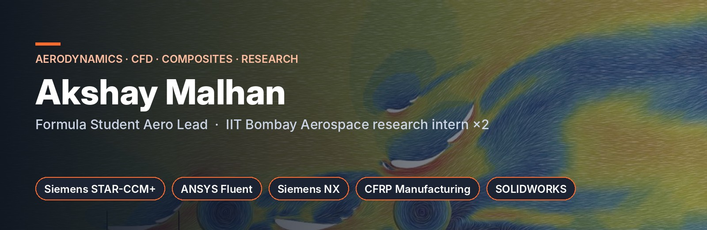
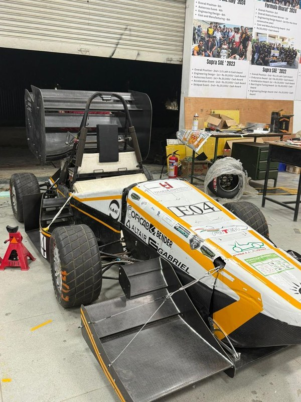
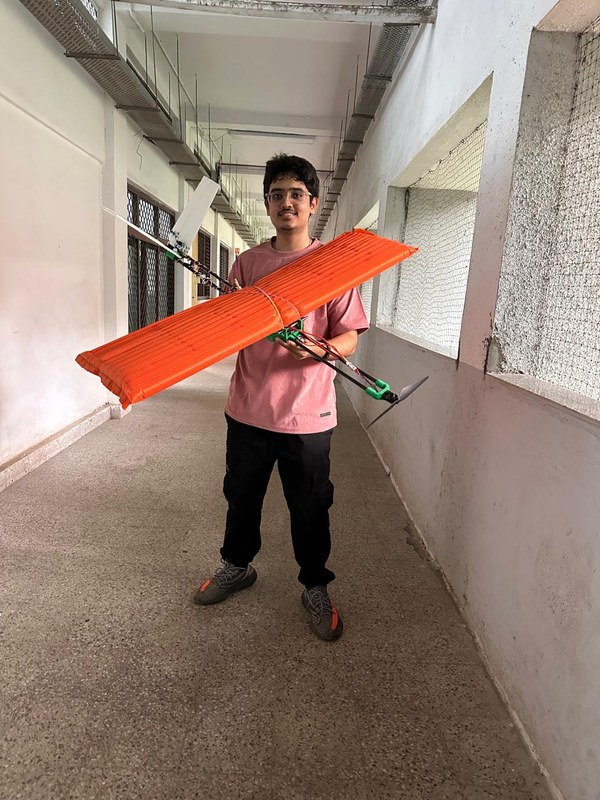
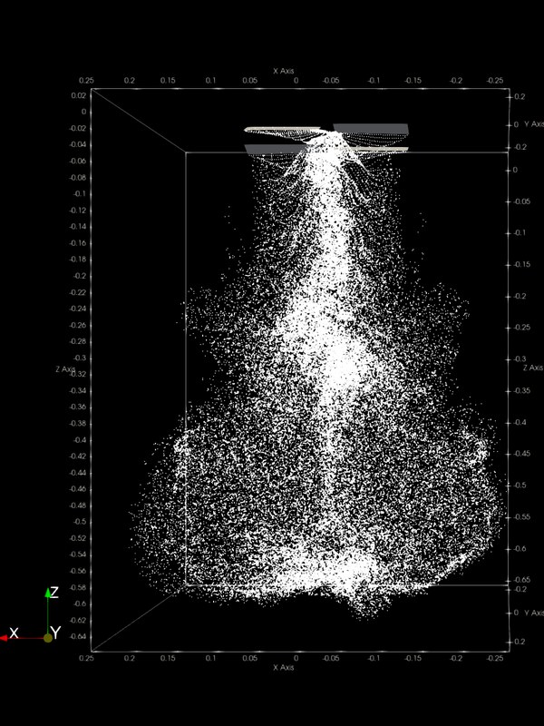

I'm a Mechanical Engineering student at **Thapar Institute** (B.E., 2027) working on **aerodynamics: design, CFD and fabrication**. I lead aerodynamics for **Team Fateh Racing** in Formula Student, and I've done two research internships in **IIT Bombay's Department of Aerospace Engineering**.

## Featured projects

<table>
<tr>
<td width="33%" valign="top">

<h3><a href="https://github.com/TheMahaanOne/fsae-aero-2026">🏎️ Formula Student aero package</a></h3>
Led Team Fateh's first complete aero package, from concept and CFD to carbon fibre.  
<b>397 N</b> downforce @ 10 m/s · <b>L/D 3.58</b> 
<b>+74</b> points in lap-time simulation 
Supra SAE 2026: <b>P3 overall, P2 Design Report</b>
</td>
<td width="33%" valign="top">

<h3><a href="https://github.com/TheMahaanOne/inflatable-wing-uav">✈️ Inflatable-wing UAV</a></h3>
Designed an inflatable-wing UAV end to end at IIT Bombay: sized the wing (1 m span, 0.3 m chord, AR 3.3), airframe length, V-tail geometry and electronics; modelled it in CAD and fabricated the <b>972 g</b> prototype with 3D-printed structures and a 5 mm Depron V-tail.  
MATLAB sizing &amp; constraint-analysis code 
MATLAB DXF generators automating the laser-cutting workflow 
<b>8 wings</b> fabricated and tested (3 LDPE, 5 nylon)
</td>
<td width="33%" valign="top">

<h3><a href="https://github.com/TheMahaanOne/coaxial-rotor-dust">🚁 Co-axial rotor CFD</a></h3>
Vortex-particle CFD of interacting rotors at IIT Bombay.  
Upstream rotor within <b>3.6 %</b> thrust and <b>6 %</b> torque of experiment 
Python post-processing toolchain
</td>
</tr>
</table>

## Toolkit

| | |
|---|---|
| **CFD & simulation** | Siemens STAR-CCM+ · ANSYS Fluent · OpenFOAM · DUST · COMSOL · XFLR5 · LS-DYNA |
| **Code & data** | MATLAB · Python (NumPy, SciPy, Matplotlib) · ParaView · Linux / WSL · MoTeC · ChassisSim |
| **CAD** | SOLIDWORKS · 3DEXPERIENCE · Siemens NX · PTC Creo |
| **Manufacturing** | CFRP resin infusion, vacuum bagging, wet layup · honeycomb sandwich panels · 3D printing · laser and waterjet cutting |

## Experience

- **Aerodynamics Lead**, Team Fateh Racing (Formula Student), Jul 2025 – present. Aerodynamicist since Oct 2023.
- **Research Intern**, Aircraft Design and Computation Lab, IIT Bombay (Prof. R. K. Pant), Jun – Aug 2026
- **Research Intern**, Low Speed Aerodynamics Lab, IIT Bombay (Prof. Dhwanil Shukla), Jun – Aug 2025
- **Engineering Trainee**, United Motorsports Academy, Jul 2024 (FIA F4 telemetry in MoTeC / ChassisSim, LS-DYNA crash simulation)
